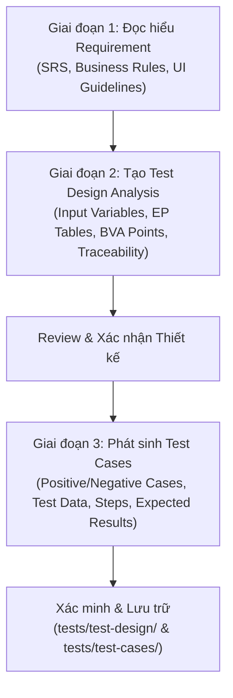

# Quy trình Thiết kế Kiểm thử theo Phương pháp Phân hoạch Tương đương (EP) & Phân tích Giá trị Biên (BVA)

Skill này hướng dẫn quy trình tiêu chuẩn 3 giai đoạn để phân tích đặc tả yêu cầu, xây dựng tài liệu Phân tích Thiết kế Kiểm thử (Test Design Specification - IEEE 829) và phát sinh bộ Test Cases chi tiết bằng kỹ thuật Phân hoạch tương đương (Equivalence Partitioning) và Phân tích giá trị biên (Boundary Value Analysis).

---

## NGUYÊN TẮC CỐT LÕI (CORE PRINCIPLES)

1. **Kiểm thử hộp đen thuần túy (Strict Black-Box):**
   - Tài liệu đặc tả yêu cầu (SRS / Acceptance Criteria / Business Rules) là nguồn chân lý duy nhất.
   - **Tuyệt đối KHÔNG soi source code** để tìm lỗi trước rồi viết test design / test case theo lỗi đó.
   - Kết quả mong đợi (Expected Result) phải được xác định 100% dựa trên quy định của SRS. Chi tiết xem tại [black_box_testing_rules.md](./references/black_box_testing_rules.md).
2. **Nguyên tắc Single Fault Assumption cho Negative Test:**
   - Mỗi kịch bản kiểm thử lỗi (Negative Test Case) chỉ được chứa **đúng 1 giá trị không hợp lệ (IEC)** của một biến đầu vào duy nhất. Tất cả các biến còn lại phải giữ ở giá trị hợp lệ (VEC) để cô lập nguyên nhân lỗi và tránh hiện tượng che giấu khuyết tật (defect masking).
3. **Cấu trúc tài liệu chuẩn:**
   - Test Design lưu tại: `tests/test-design/TD-[REQ_ID]-[feature-slug].md`
   - Test Cases lưu tại: `tests/test-cases/<module-name>/TC-[MODULE_PREFIX]-[NUMBER].md`

---

## QUY TRÌNH THỰC HIỆN 3 GIAI ĐOẠN

---

### GIAI ĐOẠN 1: ĐỌC HIỂU VÀ TRÍCH XUẤT ĐẶC TẢ YÊU CẦU

1. **Đọc kỹ tài liệu đặc tả SRS do user cung cấp:**
   - Xác định rõ mã yêu cầu (ví dụ: `FR-01`, `FR-09`, `FR-15`), mô tả tổng quan, vai trò người dùng (Actor).
   - Xác định các tiêu chuẩn kỹ thuật liên quan: GUI guidelines (màu sắc nút bấm, layout, thông báo), Security guidelines (chính sách mật khẩu, phân quyền API).
2. **Bóc tách danh sách các Quy tắc nghiệp vụ (Business Rules) và Ràng buộc dữ liệu (Constraints):**
   - **Tính bắt buộc:** Trường nào bắt buộc nhập, trường nào tùy chọn.
   - **Định dạng & Tập ký tự:** Email chuẩn RFC, mật khẩu cần chữ hoa/thường/số/ký tự đặc biệt, không chứa khoảng trắng.
   - **Khoảng giá trị & Ngưỡng biên:** Độ dài chuỗi từ $Min$ đến $Max$; Số tiền đơn hàng $\ge Min$; Giá trị phần trăm từ $0\%$ đến $100\%$.
   - **Ràng buộc logic & Trạng thái:** Ngày hiệu lực, số lần sử dụng còn lại, vai trò người dùng.
3. **Lập danh mục Biến đầu vào (Input Variables Inventory):**
   - Đánh số từng biến: $V_1, V_2, V_3, ...$
   - Ghi rõ kiểu dữ liệu, miền giá trị hợp lệ và mục tiêu kiểm thử tương ứng.

---

### GIAI ĐOẠN 2: TẠO TEST DESIGN ANALYSIS (IEEE 829 SPECIFICATION)

Cho mỗi yêu cầu chức năng, tạo file phân tích thiết kế tương ứng tại `tests/test-design/TD-[REQ_ID]-[slug].md` theo template chuẩn tại [test_design_template.md](./resources/test_design_template.md).

Tài liệu Test Design phải bao gồm đầy đủ **5 phần tiêu chuẩn**:

#### 1. Tổng quan yêu cầu & Đặc tả nghiệp vụ
Trích xuất tóm tắt nghiệp vụ, phạm vi (màn hình, endpoint) và các quy chuẩn nghiệp vụ cốt lõi từ Giai đoạn 1.

#### 2. Danh mục biến đầu vào (Input Variables Inventory)
Bảng ánh xạ các biến $V_i$, tên trường, kiểu dữ liệu, miền hợp lệ và mục tiêu kiểm thử.

#### 3. Bảng Phân hoạch tương đương (Equivalence Partitioning - EP)
Chia miền dữ liệu của từng biến thành:
- **Lớp tương đương Hợp lệ (Valid Equivalence Class - VEC):** Đặt mã `VEC-[BIẾN]-[STT]` (ví dụ: `VEC-NAME-01`, `VEC-PASS-01`).
- **Lớp tương đương Không hợp lệ (Invalid Equivalence Class - IEC):** Đặt mã `IEC-[BIẾN]-[STT]` (ví dụ: `IEC-NAME-01: chuỗi rỗng`, `IEC-PASS-01: độ dài < 8`).

#### 4. Bảng Phân tích giá trị biên (Boundary Value Analysis - BVA)
Áp dụng cho các biến có miền giá trị có thứ tự (số lượng, số tiền, độ dài chuỗi, ngày tháng):
- **Biên 2 giá trị:** Kiểm tra $\{Min, Min-1\}$ và $\{Max, Max+1\}$.
- **Biên 3 giá trị (Khuyên dùng):** Kiểm tra $\{Min-1, Min, Min+1\}$ và $\{Max-1, Max, Max+1\}$.
- Bảng chi tiết phải ghi rõ giá trị thử nghiệm cụ thể và kỳ vọng hành vi (ACCEPT / REJECT).

#### 5. Ma trận ánh xạ Test Design sang Test Cases (Traceability Matrix)
Bảng tổng hợp chuyển đổi trực tiếp:
- Mỗi dòng tương ứng với 1 Điều kiện kiểm thử (Test Condition).
- Ghi rõ kỹ thuật áp dụng (EP VEC/IEC, BVA Min/Max), Dữ liệu đại diện, Kỳ vọng theo SRS và Mã Test Case ánh xạ (`TC-[MOD]-[NUM]`).

*Tham khảo ví dụ hoàn chỉnh tại [sample_test_design_coupon.md](./examples/sample_test_design_coupon.md).*

---

### GIAI ĐOẠN 3: TẠO TEST CASES CHI TIẾT

Dẫn xuất danh sách test cases từ Ma trận ánh xạ ở Giai đoạn 2 thành các file markdown độc lập.

#### 1. Cấu trúc thư mục và quy tắc đặt tên
- Đường dẫn: `tests/test-cases/<module-name>/TC-[MODULE_PREFIX]-[NUMBER].md`
- Tham khảo quy chuẩn tiền tố tại [naming_and_directory_conventions.md](./references/naming_and_directory_conventions.md).

#### 2. Cấu trúc nội dung từng file Test Case
Sử dụng template tại [test_case_template.md](./resources/test_case_template.md), đảm bảo có đủ 7 mục bắt buộc:
1. **Tiêu đề:** `# TC-[MODULE]-[NUMBER]: [Tên kịch bản rõ ràng, súc tích]`
2. **Requirement ID:** Mã nghiệp vụ tương ứng (ví dụ: `FR-01-REG-001`).
3. **Module / Test type / Technique:** Ghi rõ kỹ thuật EP hay BVA đã dùng.
4. **Preconditions:** Trạng thái hệ thống, dữ liệu cần chuẩn bị trước.
5. **Test data:** Bảng chi tiết từng trường dữ liệu với giá trị cụ thể (không viết chung chung như "nhập mật khẩu hợp lệ").
6. **Test steps:** Các bước thao tác tuần tự (1, 2, 3...).
7. **Expected result:** Kết quả mong đợi chi tiết theo đặc tả SRS (thông báo hiển thị, điều hướng, trạng thái dữ liệu).
8. **Status / Related bugs:** Mặc định ban đầu ghi `Not Run`.

*Tham khảo ví dụ test case chuẩn tại [sample_test_case_bva.md](./examples/sample_test_case_bva.md).*

---

## CHECKLIST KIỂM TRA CHẤT LƯỢNG (VERIFICATION CHECKLIST)

Trước khi hoàn tất và bàn giao cho user, kiểm tra lại danh sách các tiêu chí sau:

- [ ] **Black-box Compliance:** Không có bất kỳ trích dẫn file mã nguồn, hàm hay suy đoán lỗi code nào trong Test Design và Test Cases.
- [ ] **EP Single Fault:** Mọi Negative Test Case đều chỉ chứa duy nhất 1 giá trị IEC; các trường còn lại đều dùng giá trị hợp lệ.
- [ ] **BVA Completeness:** Các giá trị biên $Min, Min-1, Min+1$ (và $Max$ nếu có) được kiểm tra đầy đủ với dữ liệu số cụ thể.
- [ ] **Traceability:** Ma trận ánh xạ ở mục 5 của Test Design khớp 1-1 với danh sách các file Test Cases đã tạo.
- [ ] **Test Data Specificity:** Bảng Test data trong từng file Test Case có giá trị cụ thể, không dùng placeholder mơ hồ.
- [ ] **Cấu trúc lưu trữ:** Các file đã được lưu đúng vị trí trong `tests/test-design/` và `tests/test-cases/<module>/`.
